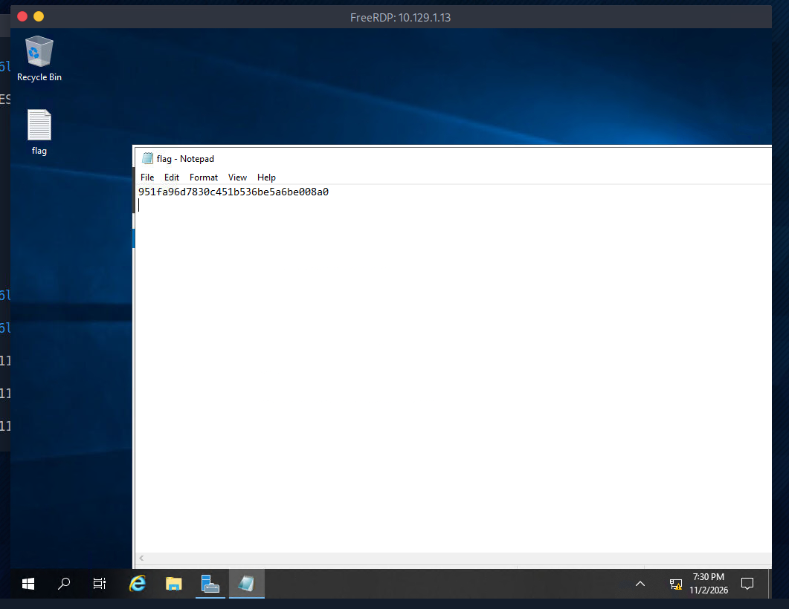

# HTB - Starting Point - Explosion

🇺🇸 [English version](./README-explosion.md)

| Info        | Detalhe             |
|-------------|----------------------|
| Plataforma  | Hack The Box         |
| Track       | Starting Point       |
| Dificuldade | Muito Fácil          |
| OS          | Windows              |
| Status      | ✅ Resolvido          |

## Sumário
- [HTB - Starting Point - Explosion](#htb---starting-point---explosion)
  - [Sumário](#sumário)
  - [Recon](#recon)
  - [Enumeration](#enumeration)
  - [Exploitation](#exploitation)
  - [Flag](#flag)
  - [Lições aprendidas](#lições-aprendidas)

---

## Recon

Iniciei a máquina alvo pela plataforma do HTB, obtendo o endereço de IP do target:

**IP do alvo:** `10.129.1.13`

Em seguida, conectei na Pwnbox (máquina de ataque fornecida pelo HTB) e, através dela, me conectei na rede do target via VPN.

Rodei um scan com o **Nmap** para identificar portas e serviços abertos no alvo:

```bash
nmap 10.129.1.13
```

```
PORT     STATE SERVICE
135/tcp  open  msrpc
139/tcp  open  netbios-ssn
445/tcp  open  microsoft-ds
3389/tcp open  ms-wbt-server
5985/tcp open  wsman
```

As portas abertas confirmaram tratar-se de um host Windows, e a porta **3389** (ms-wbt-server) indicou que o **RDP (Remote Desktop Protocol)** estava disponível.

---

## Enumeration

Com o RDP aberto, tentei uma conexão usando o `xfreerdp`, primeiro sem especificar um usuário:

```bash
xfreerdp -v:10.129.1.13
```

Isso disparou alguns avisos de certificado (certificado autoassinado, incompatibilidade de nome), que são esperados em ambientes de lab/CTF e podem ser confiáveis. A conexão também falhou nesse ponto por problemas na resolução do realm Kerberos e falta de credenciais:

```
No user name set. - Using login name: h1k4ri
...
No credentials provided - using NULL identity
...
Cannot contact any KDC for realm 'ATHENA.MIT.EDU'
```

Tentei novamente especificando explicitamente o usuário `Administrator`:

```bash
xfreerdp /u:Administrator /v:10.129.1.13
```

Quando pediu **Domain** e **Password**, deixei ambos os campos em branco (apertando Enter):

```
Domain:
Password:
```

---

## Exploitation

Apesar de não fornecer nenhuma senha, a conexão foi bem-sucedida, autenticando com uma **identidade NULL**:

```
No credentials provided - using NULL identity
...
[gdi_init_ex]: Local framebuffer format  PIXEL_FORMAT_BGRX32
```

Isso indicou que a conta `Administrator` **não tinha senha configurada**, permitindo acesso RDP não autenticado diretamente à área de trabalho.

Uma vez dentro do desktop Windows, localizei um arquivo `flag` na área de trabalho e o abri com o Notepad, revelando o conteúdo da flag diretamente:



---

## Flag

```
951fa96d7830c451b536be5a6be008a0
```

---

## Lições aprendidas

- RDP (3389) exposto à internet ou a uma rede não confiável já é um risco significativo por si só, especialmente combinado com políticas de contas fracas.
- Uma conta **sem senha configurada** (como o `Administrator` aqui) ignora completamente a autenticação — o `xfreerdp` vai conectar com uma identidade NULL quando nenhuma credencial é fornecida e o alvo permite isso.
- Avisos de certificado (autoassinado, incompatibilidade de nome) são comuns e esperados em ambientes de lab isolados como o HTB, mas nunca devem ser confiados cegamente em redes de produção reais.
- Sempre teste credenciais padrão/em branco em serviços administrativos expostos antes de assumir que uma exploração mais complexa é necessária — a falha de configuração mais simples costuma ser a vulnerabilidade real.
