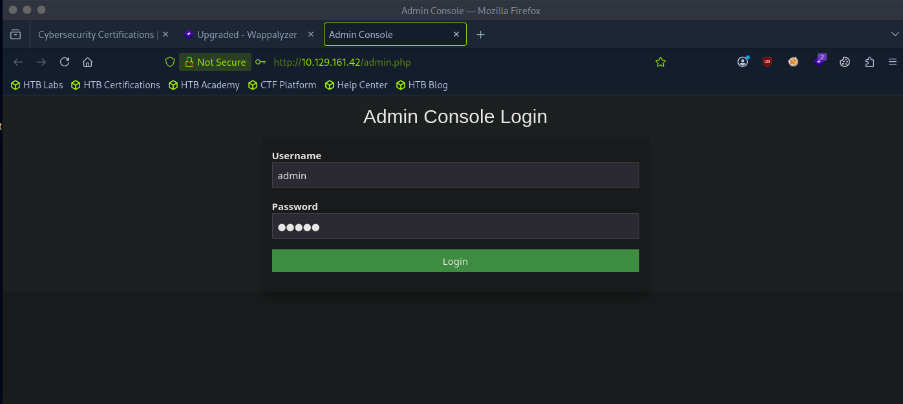
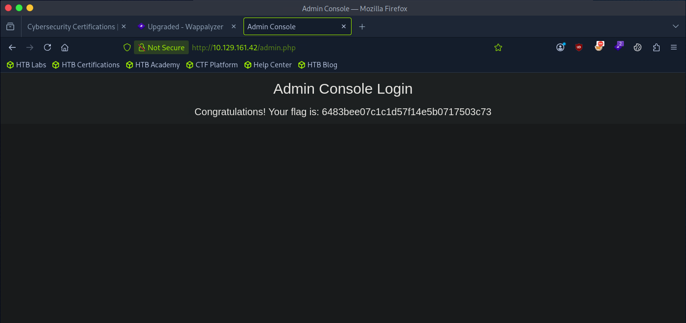

# HTB - Starting Point - Preignition

🇧🇷 [Versão em Português](./README-preignition.pt-BR.md)

| Info         | Detail        |
|--------------|---------------|
| Platform     | Hack The Box  |
| Track        | Starting Point|
| Difficulty   | Very Easy     |
| OS           | Linux         |
| Status       | ✅ Completed  |

## Table of Contents
- [HTB - Starting Point - Preignition](#htb---starting-point---preignition)
  - [Table of Contents](#table-of-contents)
  - [Recon](#recon)
  - [Enumeration](#enumeration)
  - [Exploitation](#exploitation)
  - [Flag](#flag)
  - [Lessons Learned](#lessons-learned)

---

## Recon

I started the target machine through the HTB platform, which provided the target's IP address:

**Target IP:** `10.129.161.42`

I then connected to the Pwnbox (HTB's attack machine) and, through it, connected to the target's network via VPN.

I ran an **Nmap** scan with service/version detection to identify open ports and services on the target:

```bash
nmap -sV 10.129.161.42
```

```
PORT   STATE SERVICE VERSION
80/tcp open  http    nginx 1.14.2
```

Only port **80** (HTTP) was open, running **nginx 1.14.2**.

---

## Enumeration

With a web server identified, I used `gobuster` to brute-force directories and files on the target. My first attempt was missing required flags:

```bash
gobuster dir 10.129.161.42
```

```
Error: required flag(s) "url", "wordlist" not set
```

I corrected the command, providing the URL (`-u`), a wordlist (`-w`), and common web extensions to look for (`-x`), including PHP:

```bash
gobuster dir -u http://10.129.161.42 -w /usr/share/wordlists/dirb/common.txt -x php,html,txt
```

```
/admin.php            (Status: 200) [Size: 999]
```

An `admin.php` page was found, returning a `200 OK` status — indicating it was accessible and worth investigating further.

---

## Exploitation

I navigated to the discovered page in the browser:

```
http://10.129.161.42/admin.php
```

An **Admin Console Login** form was displayed, requesting a username and password.



I tried the most basic default credentials:

- **Username:** `admin`
- **Password:** `admin`

The login succeeded, and the page immediately displayed the flag.



---

## Flag

```
6483bee07c1c1d57f14e5b0717503c73
```

---

## Lessons Learned

- Directory/file brute-forcing (`gobuster dir`) is an essential step when a web application doesn't expose obvious endpoints — hidden admin panels are commonly found this way.
- Using the `-x` flag with relevant extensions (`php`, `html`, `txt`, etc.) is critical, since many endpoints won't be found without specifying the file type.
- Always test weak/default credentials (`admin:admin`, `admin:password`, etc.) on any login form discovered — many applications, especially in training environments, are intentionally left with trivial credentials to demonstrate this exact risk.
- Even a single open port (80/HTTP) can hide a full attack surface once directory enumeration uncovers hidden pages.
