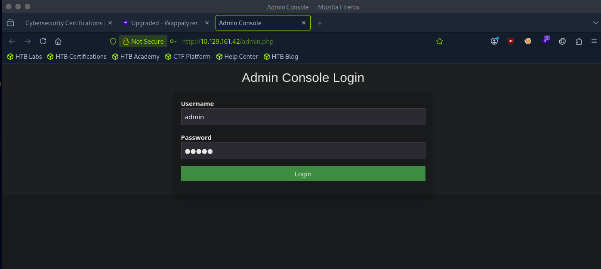
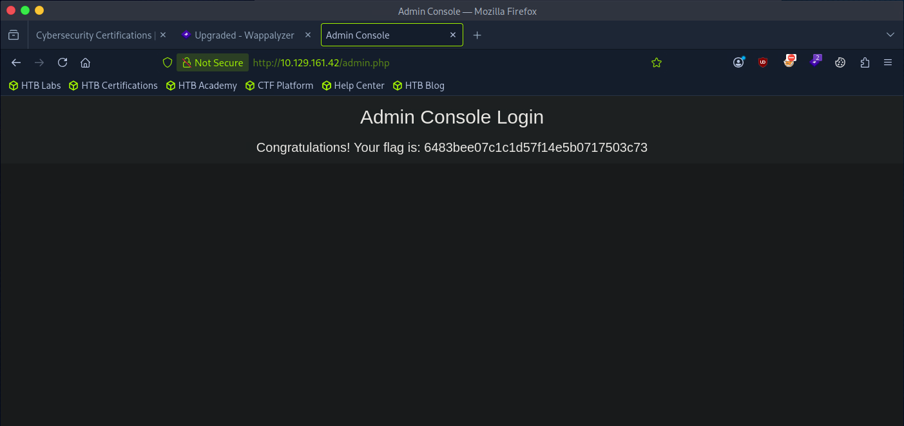

# HTB - Starting Point - Preignition

🇺🇸 [English version](./README-preignition.md)

| Info        | Detalhe             |
|-------------|----------------------|
| Plataforma  | Hack The Box         |
| Track       | Starting Point       |
| Dificuldade | Muito Fácil          |
| OS          | Linux                |
| Status      | ✅ Resolvido          |

## Sumário
- [HTB - Starting Point - Preignition](#htb---starting-point---preignition)
  - [Sumário](#sumário)
  - [Recon](#recon)
  - [Enumeration](#enumeration)
  - [Exploitation](#exploitation)
  - [Flag](#flag)
  - [Lições aprendidas](#lições-aprendidas)

---

## Recon

Iniciei a máquina alvo pela plataforma do HTB, obtendo o endereço de IP do target:

**IP do alvo:** `10.129.161.42`

Em seguida, conectei na Pwnbox (máquina de ataque fornecida pelo HTB) e, através dela, me conectei na rede do target via VPN.

Rodei um scan com o **Nmap** com detecção de serviço/versão para identificar portas e serviços abertos no alvo:

```bash
nmap -sV 10.129.161.42
```

```
PORT   STATE SERVICE VERSION
80/tcp open  http    nginx 1.14.2
```

Apenas a porta **80** (HTTP) estava aberta, rodando **nginx 1.14.2**.

---

## Enumeration

Com um servidor web identificado, usei o `gobuster` para fazer brute-force de diretórios e arquivos no alvo. Minha primeira tentativa ficou sem as flags obrigatórias:

```bash
gobuster dir 10.129.161.42
```

```
Error: required flag(s) "url", "wordlist" not set
```

Corrigi o comando, fornecendo a URL (`-u`), uma wordlist (`-w`) e extensões web comuns para procurar (`-x`), incluindo PHP:

```bash
gobuster dir -u http://10.129.161.42 -w /usr/share/wordlists/dirb/common.txt -x php,html,txt
```

```
/admin.php            (Status: 200) [Size: 999]
```

Uma página `admin.php` foi encontrada, retornando status `200 OK` — indicando que era acessível e valia a pena investigar mais a fundo.

---

## Exploitation

Naveguei até a página descoberta no navegador:

```
http://10.129.161.42/admin.php
```

Um formulário de **Admin Console Login** foi exibido, pedindo usuário e senha.



Testei as credenciais padrão mais básicas:

- **Usuário:** `admin`
- **Senha:** `admin`

O login foi bem-sucedido, e a página exibiu a flag imediatamente.



---

## Flag

```
6483bee07c1c1d57f14e5b0717503c73
```

---

## Lições aprendidas

- A enumeração de diretórios/arquivos (`gobuster dir`) é um passo essencial quando uma aplicação web não expõe endpoints óbvios — painéis administrativos escondidos são frequentemente encontrados dessa forma.
- Usar a flag `-x` com extensões relevantes (`php`, `html`, `txt`, etc.) é fundamental, já que muitos endpoints não são encontrados sem especificar o tipo de arquivo.
- Sempre teste credenciais fracas/padrão (`admin:admin`, `admin:password`, etc.) em qualquer formulário de login encontrado — muitas aplicações, especialmente em ambientes de treinamento, são deixadas propositalmente com credenciais triviais para demonstrar exatamente esse risco.
- Até mesmo uma única porta aberta (80/HTTP) pode esconder uma superfície de ataque completa quando a enumeração de diretórios revela páginas ocultas.
